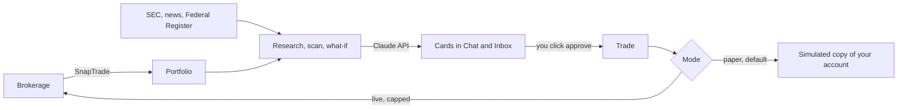

# Atlas

An AI investing agent for a brokerage account connected through [SnapTrade](https://snaptrade.com). Atlas reads what you hold, reads public sources about it (SEC filings, news, Federal Register notices), and tells you in plain words when something matters. It can research a stock, trace a what-if through your holdings, and suggest a trade. **It never trades on its own:** a trade only happens when you click a decision card, and live orders are capped in server code.

Built for SnapTrade Hack Atlantic 2026 (Student Challenge).

- [How it works](#how-it-works)
- [Features](#features)
- [Getting started](#getting-started)
- [Configuration](#configuration)
- [Safety model](#safety-model)
- [Using Atlas with Claude](#using-atlas-with-claude)
- [Deploying to Vercel](#deploying-to-vercel)
- [Tests](#tests)
- [Project layout](#project-layout)
- [Design notes and limits](#design-notes-and-limits)

## How it works



Three things are worth knowing before reading the code.

1. **Two kinds of output.** *Chat* is where you ask for things; each conversation is a thread. The *Inbox* is where Atlas puts what it finds by itself: scan results, rule alerts, daily briefs and trades waiting for your yes or no. Both are lists of cards stored in one document.
2. **Reading is free, acting is gated.** The model has no tool that places an order. A proposal becomes a decision card, and `src/app/api/action/route.ts` is the only code path that trades, and only when a person clicks.
3. **Three ways in.** The web app, Claude through an MCP server (same tools, same store), and Claude Deep Research on claude.ai through a Chrome extension (research runs on your Claude plan instead of the API key).

## Features

- **Research.** Eight analysts each take one angle on a stock. Six start from the sources Atlas collects (business, financial health, valuation, industry, regulation, people and operations); two are open and plan their own web searches each time, a news scout for what just happened and a skeptic for the case against. All of them search the web and write a short cited report. They read each other's reports and argue once, then a judge gives a verdict (buy more, sell some, hold) with a 0-100 confidence score. *Review my portfolio* does this for the three biggest holdings.
- **What-if.** "What if Taiwan blocks chip exports?" A planner splits the scenario into the ways it could spread, researchers read the news for each, and a synthesizer maps it onto your holdings with a rough dollar range. The dollar math is done in code, not by the model.
- **Scan and rules.** Rule checks (concentration, drawdown, idle cash, price levels) are plain arithmetic. Rules are added on the *Rules & topics* page, which also shows what each one finds right now. *Check now* in the Inbox runs the rules, reads new filings and headlines, and posts a note or a decision card.
- **Daily run.** Once a day: what changed, what the rules flagged, research on the next holding in rotation, and suggestions you can try as paper trades. Off until you turn it on.
- **Ask.** Questions about the portfolio or an investing term, answered in the current thread. If a question needs research or a what-if, the answer comes with a button that runs it, so a slow and costly job never starts without a click. Atlas keeps a one-line note of each answer so later answers have context.
- **Paper and live mode.** Paper mode (the default) trades a simulated copy of your account priced with live quotes. Live mode sends real market orders through SnapTrade.

## Getting started

You need Node.js 20.9 or newer, an [Anthropic API key](https://console.anthropic.com), and a SnapTrade account (a free sandbox works and trades fake money).

```bash
npm install
cp .env.example .env.local   # fill in the keys, see below
npm run dev                  # http://localhost:3000
```

Without SnapTrade keys the app still starts and shows a clearly labelled demo portfolio, so you can look around before connecting anything. Connect a brokerage from *Settings*.

State is one JSON document in `.data/store.json`. *Start over* (under Settings) clears it and keeps the brokerage link.

## Configuration

Set these in `.env.local`. `.env.example` has the same list with comments.

| Variable | What it's for |
|---|---|
| `ATLAS_ANTHROPIC_API_KEY` | Claude API key. Wins over an `ANTHROPIC_API_KEY` already set in the shell. |
| `SNAPTRADE_CLIENT_ID`, `SNAPTRADE_CONSUMER_KEY` | SnapTrade dashboard → API keys. |
| `SNAPTRADE_AUTH_MODE` | `personal` (default) for dashboard keys, where brokerages are linked in the dashboard or with the Connect button. `commercial` for app keys, where Atlas registers a SnapTrade user itself. |
| `SNAPTRADE_BROKER` | Optional. Opens the connection portal on one broker, e.g. `ALPACA-PAPER`. |
| `SEC_USER_AGENT` | Optional contact string, which SEC EDGAR asks for. |
| `ATLAS_PASSWORD` | Puts the app behind a sign-in. Optional locally, required when hosted. |
| `CRON_SECRET`, `KV_REST_API_URL`, `KV_REST_API_TOKEN` | Hosted only. See [Deploying to Vercel](#deploying-to-vercel). |
| `ATLAS_APP_URL` | The deployment's address, used in the notes the MCP server gives Claude. Default `http://localhost:3000`. |

**Cost.** Research runs on Claude Opus 5.5, most of the cost being the web pages the analysts read. It measured about $1.50 per stock with four analysts; eight cost more (each searches three times instead of five to keep that down) and haven't been measured yet. Questions in Chat use Claude Sonnet 5.5 at medium effort, about half a cent each (`CHAT_MODEL` in `src/lib/llm.ts`). The Claude Deep Research route below costs the API nothing.

## Safety model

Atlas is built so that a wrong answer from the model costs a bad suggestion, not money.

- The model has no order-placing tool. Only a click on a decision card reaches `src/app/api/action/route.ts`, and a card can be decided once, so a double click does not trade twice.
- Live orders are capped at $25 per trade and $100 per day in `src/lib/trading.ts`, whatever the card says.
- Switching to live mode requires typing `LIVE` and a connected account. A hosted copy stays in paper mode.
- Suggestions from the daily run are always paper trades.
- Writes are accepted only from the Atlas page or its Chrome extension, and only as JSON (`src/proxy.ts`). Any other website you visit cannot plant a card or a trade.
- A hosted copy refuses to serve anything until `ATLAS_PASSWORD` is set.

**Default guardrails** for a new store: flag a single stock above 25% of the portfolio (funds are not counted), flag a stock 10% below its purchase price, mention cash above 10%. Change them on the *Rules & topics* page.

### SnapTrade calls

- **Connect:** the hosted connection portal (`loginSnapTradeUser`, `connectionType: "trade"`).
- **Read:** `listUserAccounts`, `getAllAccountPositions`, `getUserAccountBalance`, `getUserAccountRecentOrders`, and quotes from `getUserAccountQuotes`.
- **Live orders:** market orders through `placeForceOrder`, sized in dollars.

## Using Atlas with Claude

### MCP server

The MCP server gives Claude the same tools as the app. Claude can propose a trade; it cannot place one. It shares `.env.local` and `.data/` with the web app.

```bash
npm run mcp     # stdio server
```

Claude Code: `claude mcp add atlas -- npx -y tsx /path/to/atlas/src/mcp/server.mts`

Claude Desktop (`claude_desktop_config.json`):

```json
{
  "mcpServers": {
    "atlas": { "command": "npx", "args": ["-y", "tsx", "/path/to/atlas/src/mcp/server.mts"] }
  }
}
```

| Tool | What it does |
|---|---|
| `atlas_get_portfolio` | Holdings, mode and live limits |
| `atlas_research_company` | Research on one stock |
| `atlas_review_portfolio` | Research on the three biggest holdings |
| `atlas_what_if` | What-if on the current holdings |
| `atlas_scan` | Rule checks and a public-sources scan |
| `atlas_propose_trade` | Creates a decision card. It does not trade. |
| `atlas_pending_decisions` | What the user approved or declined |
| `atlas_rules` | List, add or remove rules |
| `atlas_daily_run`, `atlas_daily_schedule` | Run the daily check, or change its schedule |
| `atlas_memory` | Read or add to the notes Atlas keeps between conversations |

Cards Claude creates are marked "From Claude" in the app.

### Deep Research in Claude (Chrome extension)

Atlas's own research costs API credits. The same research can run in Claude Deep Research on claude.ai, paid for by your Claude plan (Pro or higher; the free plan has no Research mode). The extension connects the two:

1. You click **Deep research in Claude** in Atlas.
2. A claude.ai tab opens with Research turned on and a prompt that includes your position and what Atlas already found.
3. You press send and keep the tab open for about ten minutes.
4. Claude ends its report with an `ATLAS_RESULT` JSON block. The extension reads it and Atlas turns it into a normal research card. Importing is plain code (`src/lib/handoff.ts`), with no model call.

The button only appears once the extension is set up. The **Claude setup** tab in Atlas has the downloads and the install steps, and works for Atlas on your computer or on a hosted address you add once. The extension's own notes, security model and troubleshooting are in [extension/README.md](extension/README.md). If an import ever fails, **Bring back a Claude report** under Settings accepts the pasted answer.

### Claude skill

`claude-skill/atlas-stock-research/` is an optional Claude skill for this hand-off. It carries the method (five analyst passes, a debate, a judge with a confidence rubric), the checklists each pass works from, a fixed report format, and a script that checks the `ATLAS_RESULT` block the way Atlas parses it.

Download the zip from the **Claude setup** tab, or zip the folder yourself so that `atlas-stock-research/` is at the top, then upload it in Claude under Settings → Customize → Skills (code execution has to be on). Anthropic's docs don't say whether Research mode loads skills, so the prompt Atlas sends also names the skill and carries the report outline. It works without the skill installed.

## Deploying to Vercel

1. Import the repository.
2. Add Upstash Redis from the Storage tab. Vercel has no writable disk, so the state lives in Redis there (`KV_REST_API_URL`, `KV_REST_API_TOKEN`).
3. Set the variables from the table above, plus `ATLAS_PASSWORD` and `CRON_SECRET` (a long random string).
4. Deploy.

Every push to the production branch deploys by itself once the repository is connected.

`vercel.json` calls `/api/cron/daily` once a day at 13:00 UTC, so on Vercel the daily run starts then rather than at the time picked in the app. Requests are limited to 300 seconds, and a stock took about a minute and a half with four analysts (not re-measured with eight), so keep the daily run at one or two stocks.

## Tests

```bash
npm test
npm run typecheck
npm run lint
```

The tests cover the parts where a mistake costs money or leaks access: trade execution and the live caps, decision cards, rule checks and adding rules, sign-in and the write checks, research citations, which chat an answer belongs to, and the zips served on the Claude setup tab. They need no keys and make no network calls; the model is replaced by a stand-in. They do not cover a real order reaching a broker, reading a real SnapTrade account, or the browser (including the extension).

## Project layout

```
src/app/            pages and API routes (Next.js App Router)
src/components/     the UI: Portfolio, Chat, Inbox, Daily run, Rules & topics, Claude setup, Settings
src/lib/            everything the app does, one file per concern (below)
src/mcp/server.mts  MCP server
src/proxy.ts        sign-in and write checks, run before every request
extension/          Chrome extension for Deep Research in Claude
claude-skill/       Claude skill for the same hand-off
tests/              node:test suites
```

In `src/lib/`:

- `snaptrade.ts`: SnapTrade client
- `portfolio.ts`: real, paper and demo portfolios
- `trading.ts`: executing an approved trade, live caps
- `rules.ts`: rule checks
- `sources.ts`: SEC EDGAR, Google News RSS, Federal Register
- `research.ts`, `review.ts`: analysts, debate, judge, and posting the result
- `scenario.ts`: what-if
- `scan.ts`, `watch.ts`: headline triage and cards; one pass of rule checks plus the public-sources scan
- `daily.ts`, `scheduler.ts`: the daily run and its timer (checked once a minute in the server process locally, `src/app/api/cron/daily/route.ts` on Vercel)
- `chat.ts`, `threads.ts`: answering in a chat, the chat list, memory
- `handoff.ts`: Claude Deep Research prompt and import
- `store.ts`: state, as a file or one Redis key
- `auth.ts`: sign-in
- `zip.ts`: builds the downloads on the Claude setup tab

## Design notes and limits

- **One document, one user.** The whole state is a single JSON document (a file, or one Redis key). It keeps the code small and the state easy to inspect, and it means Atlas is a single-user app: there are no accounts, only the optional password.
- **Claude's answers are parsed, not trusted.** Structured model output goes through a schema (zod). The imported Deep Research block is validated the same way: it needs a real verdict and at least one source, so the prompt's own template cannot be imported by mistake, and a citation that points at no source is dropped.
- **The extension depends on claude.ai's page.** It finds the Research menu and the message box by their selectors (`SEL` at the top of `extension/claude.js`). If claude.ai changes its markup, those need updating; the fallback is the paste-back box under Settings.
- **Not verified end to end:** live orders and the connection portal against a real brokerage, the scheduled daily run on a long-lived server, and the extension's hosted-address flow in a real browser. The sandbox covers reading and paper trading.
- **Not financial advice.** Atlas produces research and suggestions. You make the decisions.
